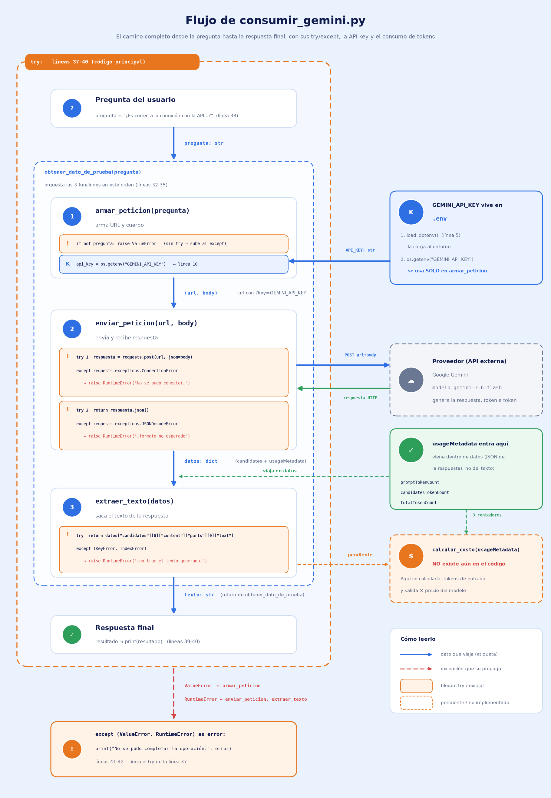

# Decisión de arquitectura: elección de modelo

## Modelo elegido

**Gemini 3.6 Flash**, para la funcionalidad principal de la miniaplicación.

## Diagrama de arquitectura

El flujo completo va desde la pregunta del usuario hasta la respuesta final, pasando por `armar_peticion`, `enviar_peticion` (con la credencial `GEMINI_API_KEY` leída desde `.env` y el manejo de errores en `try/except`) y `extraer_texto` (que además calcula el costo a partir de `usageMetadata`). El diagrama completo está en `docs/diagrama_flujo_consumir_gemini.png`.

## Comparación de candidatos

| Criterio                                | Gemini 3.6 Flash                                       | Gemini 4 Argon                                              |
| --------------------------------------- | ------------------------------------------------------ | ----------------------------------------------------------- |
| Costo por 1 millón de tokens de entrada | Entrada a USD 0.75 (luego USD 1.50 desde el 1/01/2027) | Entrada a USD 1.00 (luego USD 2.00 desde el 1/12/2026)      |
| Costo por 1 millón de tokens de salida  | Salida a USD 3.75 (luego USD 7.50)                     | salida a USD 5.00 (luego USD 10.00)                         |
| Latencia promedio observada             | 1,6 segundos                                           | 3,9 segundos                                                |
| Calidad de respuesta para el caso       | Buena: cubre lo esencial en las 3 preguntas de prueba  | Muy buena: más detalle y matices en las mismas 3 respuestas |
| Fecha de medición                       | 20-10-2026                                             | 20-10-2026                                                  |

## Justificación

Esta miniaplicación es un asistente simple, donde una respuesta que "cubre lo esencial" ya satisface lo que el usuario necesita. Con ese requisito, el criterio que más pesó fue la relación entre precio y latencia, y **Gemini 3.6 Flash** gana en ambos frentes según la tabla de comparación (medición del 20-10-2026):

- **Latencia:** responde en 1,6 segundos de promedio frente a 3,9 segundos de Gemini 4 Argon. Es 2,4 veces más rápido, con 2,3 segundos menos de espera en cada consulta, una diferencia que el usuario percibe directamente en una aplicación conversacional.
- **Precio:** es más barato tanto en entrada (USD 0.75 vs USD 1.00 por millón de tokens) como en salida (USD 3.75 vs USD 5.00). Argon cuesta un 33 % más en ambos casos, y esa proporción se mantiene tras los aumentos anunciados (USD 1.50 / 7.50 desde el 1/01/2027 para Flash y USD 2.00 / 10.00 desde el 1/12/2026 para Argon).
- **Calidad:** la calidad "buena" de Flash cubre lo esencial en las 3 preguntas de prueba, que es lo que el caso de uso exige. El detalle adicional de Argon no es un requisito de la aplicación.

La diferencia de precio es moderada, por lo que el factor decisivo es la latencia. Aun así, Flash es mejor o igual en los criterios que importan para esta aplicación, por lo que es la elección más razonable con los datos disponibles.

## Alternativa descartada y por qué

Se descartó **Gemini 4 Argon**. Ofrece respuestas con más detalle y matices, pero esa ventaja de calidad no se necesita en esta miniaplicación y tiene un costo concreto: el usuario esperaría más del doble de tiempo por cada respuesta (3,9 s frente a 1,6 s) y cada interacción costaría un 33 % más en tokens de entrada y de salida. Además, Argon adelanta su aumento de precio al 1/12/2026, un mes antes que Flash.

Esta decisión debería revisarse si la aplicación pasa a requerir respuestas más elaboradas, o si los precios de Flash dejan de ser competitivos tras su ajuste de enero de 2027.
